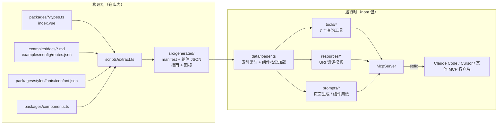
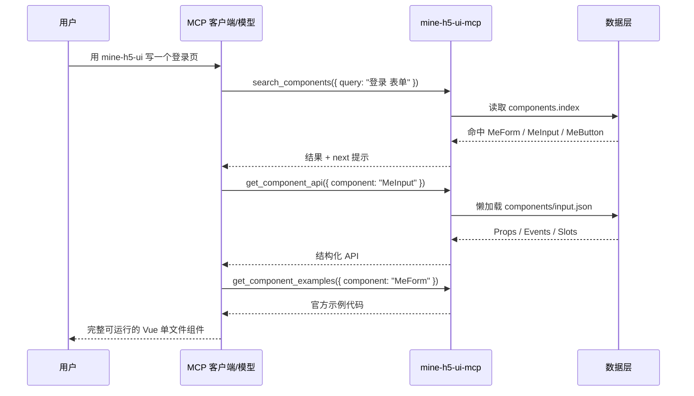

# mine-h5-ui MCP 服务方案

> 文档状态：待评审  
> 编写日期：2026-11-11  
> 目标组件库版本：mine-h5-ui v2.19.x  
> 交付形态：独立 npm 包 `mine-h5-ui-mcp`，stdio 传输  
> 首版范围：查询类工具（API / 示例 / 图标 / 指南），不含代码生成执行与用法校验

---

## 1. 背景与目标

### 1.1 问题

mine-h5-ui 目前有 60+ 组件、75 篇文档。AI 编码助手（Claude Code、Cursor、Copilot 等）在编写业务代码时，通常只能依赖训练数据中的模糊记忆，容易产生以下问题：

- 编造不存在的 Props、事件或插槽。
- 记错枚举值，例如把 `type="primary"` 写成 `type="main"`。
- 不知道组件的按需引入方式与对应样式文件路径。
- 图标名称大量且中英文混杂，凭记忆几乎无法准确命中。
- 文档中的示例代码没有被有效利用，生成结果与官方推荐用法不一致。

### 1.2 目标

提供一个本地运行、零部署成本的 MCP 服务，让 AI 助手能够：

1. 以结构化方式查询任意组件的 Props、Events、Slots、Methods 与类型定义。
2. 获取官方文档中的完整代码示例，而不是让模型凭空生成。
3. 按关键字或中文含义检索图标。
4. 获取安装、主题、样式变量等指南，生成可直接运行的页面代码。
5. 元数据随组件库版本自动更新，避免“文档与代码脱节”。

### 1.3 非目标（首版不做）

- 不在服务端执行用户代码，不做构建、预览或截图。
- 不做 Props/事件的运行时校验与自动修复。
- 不提供远程 HTTP/SSE 托管服务。
- 不做多版本文档聚合（首版只打包当前发布的组件库版本）。
- 不做向量检索或嵌入模型；60+ 组件的规模用确定性检索足够。

---

## 2. 使用场景与用户故事

| 编号 | 场景 | 用户故事 |
| ---- | ---- | -------- |
| S1 | 组件 API 查询 | 作为使用组件库的开发者，我希望 AI 在写 `<me-button>` 前能确认 `type` 的可选值和默认值，避免编译通过但行为错误。 |
| S2 | 示例复用 | 作为开发者，我希望 AI 给出的表单校验代码直接来自官方示例，而不是自行拼凑。 |
| S3 | 页面搭建 | 作为开发者，我希望对 AI 说“用 mine-h5-ui 写一个登录页”，它能自行检索 Input、Form、Button、Toast 并生成完整单文件组件。 |
| S4 | 图标选择 | 作为开发者，我希望按“关闭”“删除”“加载”等中文含义找到可用的 `icon-xxx` 名称。 |
| S5 | 接入指南 | 作为 AI，我需要知道组件库是按需引入还是全量引入、样式如何引入，才能生成能跑的代码。 |

典型交互链路：

```text
用户：用 mine-h5-ui 做一个登录页
  → search_components("登录 表单")        找到 MeForm / MeInput / MeButton / MeToast
  → get_guide("install")                获取安装与引入方式
  → get_component_api("MeInput")        确认 props / 事件
  → get_component_examples("MeForm")    参考官方校验示例
  → search_icons("用户 密码 关闭")       选取图标
  → 模型基于以上事实生成单文件 Vue 组件
```

---

## 3. 总体架构

### 3.1 架构分层



设计要点：

- **构建期与运行期彻底分离**：运行时只读随包发布的 JSON，不依赖组件库源码，也不需要用户安装 mine-h5-ui。
- **索引常驻、详情按需**：启动时只加载精简索引（列表、搜索关键字、图标），单个组件的完整元数据在首次访问时加载并缓存，控制内存与启动耗时。
- **只读服务**：不访问网络、不写文件、不执行代码，攻击面极小。

### 3.2 典型请求时序



---

## 4. 技术选型

| 领域 | 选型 | 理由 |
| ---- | ---- | ---- |
| 语言 | TypeScript（strict） | 与组件库一致，便于共享类型定义 |
| MCP SDK | `@modelcontextprotocol/sdk` | 官方 SDK，支持 Tools / Resources / Prompts 与 stdio |
| 参数校验 | `zod` | SDK 原生使用 zod 定义输入 schema，同时用于数据快照校验 |
| 源码解析 | TypeScript Compiler API | 无需引入重量级文档生成器，直接读取 `types.ts` 的 JSDoc、属性与类型 |
| SFC 解析 | `@vue/compiler-sfc` | 提取 `withDefaults` 默认值、`defineOptions`、`defineEmits` / `defineSlots` |
| Markdown 解析 | `markdown-it` | 仓库文档语法标准，能稳定拿到标题树、表格、代码块 token |
| 构建 | `tsup` + 数据复制脚本 | 支持无扩展名导入、打包为单文件 ESM，`bin` 指向 `dist/index.js`；类型检查由 `tsc --noEmit` 独立完成 |
| 开发运行 | `tsx` | 直接运行 TS 提取脚本与调试入口 |
| 验证 | `scripts/check-data.ts` + MCP 客户端手工验证 | 首版不引入自动化测试框架，保持依赖精简；数据问题由校验脚本拦截 |
| 数据传输 | stdio | 本地零部署，Claude Code/Cursor 原生支持 |

约束说明：

- 开发与构建沿用仓库的 Node `>=24.3`；发布包的 `engines` 建议放宽到 `>=20`（以 MCP SDK 实际要求为准）。
- 所有日志写入 **stderr**，stdout 专用于 MCP 协议帧，禁止在服务运行期间向 stdout 打印调试信息。

---

## 5. 元数据管线

### 5.1 数据源

| 数据 | 来源 | 用途 |
| ---- | ---- | ---- |
| 组件分类 | `examples/config/routes.json` | 分类、英文名、中文名、文档 slug |
| 组件导出与分类注释 | `packages/components.ts` | 导出名、分类块、行尾中文短说明 |
| Props / Emits 类型 | `packages/MeXxx/types.ts` | 类型、必填性、JSDoc 描述、枚举联合类型 |
| 默认值 | `packages/MeXxx/index.vue` 中 `withDefaults` | 运行时默认值 |
| Slots / 事件说明 / 版本 | `examples/docs/*.md` 的 API 表格 | 中文描述、可选值、默认值、引入版本 |
| 代码示例 | `examples/docs/*.md` 的 `## 代码演示` | 示例标题、说明、代码块 |
| 指南 | `examples/docs/{install,start,theme,var,...}.md` | 安装、主题、全局变量、开发指南等 |
| 图标 | `packages/styles/fonts/iconfont.json` | `font_class`、中文/英文 name、unicode |
| 版本 | 根目录 `package.json` | 写入 `manifest.libraryVersion` |

### 5.2 提取流程

```text
scripts/extract.ts
  1. loadRoutes()            解析 routes.json → 指南列表、组件分类与文档 slug
  2. loadExports()           解析 components.ts → exportName ↔ category ↔ 短说明
  3. extractSources()        遍历 packages/Me*/：
                               - types.ts：Props / Emits / 局部类型别名（含 JSDoc）
                               - index.vue：withDefaults 默认值、defineOptions.name
                               - 异常组件回退到文档，并记录 warning
  4. extractDocs()           解析 75 篇 md：
                               - 标题树
                               - 按需引入片段
                               - 代码演示示例
                               - API 分区：参数 / Slots / 方法 / Option / rules 等表格
  5. extractIcons()          解析 iconfont.json
  6. merge()                 合并、去重、冲突检测
  7. validate()              zod 校验 + 数量与完整性断言
  8. write()                 输出 src/generated/
```

解析规则：

- **标题树解析**：按 ATX 标题层级构建树。`## 代码演示` 下的每个 `###` 视为一个示例；`## API` 下的 `### MeXxx` 视为一个子组件分区，`####` 视为能力分区（参数 / Slots / 方法）。兼容两种写法：
  - 单组件：`### 参数`、`### Slots`、`### 方法`。
  - 复合组件：`### MeCheckboxGroup` → `#### 参数` / `#### Slots` / `#### 方法`；以及 `### 参数` → `#### MeTab` / `#### MeTabItem` 的嵌套写法。
- **表格归一化**：表头做中文别名映射，例如 `参数 | 属性 | Props` → `name`，`说明 | 描述` → `description`，`可选值` → `values`（按 `/` 拆分），`默认值` → `default`，`版本` → `since`，`回调参数` → `params`，`具名插槽 | 插槽名` → `name`。
- **`modelValue(v-model)`**：规范化为 `modelValue`，并标记 `vModel: true`。
- **代码块**：保留语言标记；一个示例含多个代码块时保留 `blocks[]`，不做拼接。
- **组件描述**：取 H1 之后、首个二级标题之前的首个非空段落；没有段落时使用 `components.ts` 的行尾短说明；两者都没有时留空，不使用模板文案填充。
- **异常兜底**：任何文档解析失败只记录 warning 并跳过该分区，不中断整体构建；出现 fatal 级错误（如组件索引为空）时构建失败。

### 5.3 合并策略与冲突处理

| 字段 | 权威来源 | 说明 |
| ---- | -------- | ---- |
| Prop 名称、类型、必填性 | `types.ts` | 类型以 TS 为准，保留原始文本（如 `ButtonType`、`[string, number]`） |
| Prop 默认值 | `index.vue` 的 `withDefaults` | 没有默认值时回退文档表格 |
| 中文描述、可选值、引入版本 | 文档表格 | 文档缺失时回退 JSDoc |
| Events 名称 | `Emits` 接口 | 与文档方法表按名称合并 |
| Slots | 文档表格 | `defineSlots` 仅用于标记存在性，不解析泛型展开 |
| 示例、指南 | 文档 | 原样保留代码与说明 |
| 子组件划分 | 文档 API 分区 | 与 `packages/MeXxx` 目录合并为 `parts[]` |

冲突处理：

- TS 有、文档无 → 保留 TS 数据，记录 `warning: prop-not-documented`。
- 文档有、TS 无 → 保留文档数据，记录 `warning: prop-not-in-ts`（可能来自原生属性透传或组合组件）。
- 默认值不一致 → 以 `withDefaults` 为准，记录 `warning: default-mismatch`。
- 所有 warning 汇总到 `manifest.warnings`，`check` 命令在 warning 数超过阈值时非零退出。

### 5.4 数据结构

```ts
/** 组件索引项（常驻内存，供列表与搜索） */
interface ComponentIndexItem {
  id: string // 文档 slug，如 'button'
  name: string // 主组件名，如 'MeButton'
  tag: string // 'me-button'
  title: string // 'Button 按钮'
  zhName: string // '按钮'
  category: string // '基础组件'
  kind: 'component' | 'api' // 封装类文档（API/正则/组合式 API）通过 get_guide 暴露，不进入组件索引
  parentId?: string // 子组件指向主组件，如 MeCheckbox → checkbox
  description: string
  keywords: string[] // Props / Events / 示例标题等，构建期生成，用于检索
  docUrl: string
}

/** 组件完整元数据 */
interface ComponentMeta extends ComponentIndexItem {
  since?: string
  importCode: string // 按需引入片段
  stylePath: string // 'mine-h5-ui/styles/MeButton.css'
  parts: ComponentPart[]
  examples: ExampleMeta[]
  markdown: string // 原始文档，供 get_component_doc 使用
}

interface ComponentPart {
  name: string // 'MeButton' / 'MeCheckboxGroup'
  props: PropMeta[]
  events: EventMeta[]
  slots: SlotMeta[]
  methods: MethodMeta[]
  types: TypeMeta[] // 局部类型别名，如 ButtonType
  extraTables: RawTable[] // Option / rules / 回调数据等未归一化表格
}

interface PropMeta {
  name: string
  type: string
  required: boolean
  default?: string
  values?: string[]
  description?: string
  since?: string
  vModel?: boolean
  source: 'ts' | 'doc' | 'both'
}

interface EventMeta {
  name: string
  params?: string
  description?: string
  since?: string
}

interface SlotMeta {
  name: string
  description?: string
  scoped?: string
  since?: string
}

interface ExampleMeta {
  title: string
  description: string
  blocks: { language: string; code: string }[]
}

interface IconMeta {
  name: string // 'icon-success'，可直接传给 <me-icon name>
  label: string // iconfont 中的 name，可能是中文
  fontClass: string
  unicode: string
}
```

### 5.5 产物布局

```text
mcp/src/generated/
├── manifest.json            # libraryVersion、generatedAt、总数、warnings、hash
├── components.index.json    # ComponentIndexItem[]，约 60–80 KB
├── components/
│   ├── button.json          # ComponentMeta（含 markdown）
│   ├── checkbox.json
│   └── ...
├── guides.index.json        # 指南标题与 slug
├── guides/
│   ├── install.json
│   └── ...
└── icons.json               # IconMeta[]，约 70 条
```

构建时整目录复制到 `dist/generated/`；运行时通过 `import.meta.url` 相对定位，不依赖仓库源码路径。

---

## 6. MCP Server 设计

### 6.1 Tools

所有工具均只读，参数使用 zod 描述，方便模型正确调用。

| 工具 | 作用 | 参数 | 返回概要 |
| ---- | ---- | ---- | -------- |
| `list_components` | 浏览组件目录 | `category?`、`kind?` | 分类列表 + 精简组件项 + 指南目录 |
| `search_components` | 按关键字检索组件 | `query`、`category?`、`limit=8` | 命中项、得分、命中字段、推荐下一步 |
| `get_component_api` | 获取组件 API | `component`、`include?`、`include_examples?=false` | `parts[]` 的 Props / Events / Slots / Methods / Types |
| `get_component_examples` | 获取官方示例 | `component`、`scenario?`、`limit=3` | 示例标题、说明、代码块 |
| `get_component_doc` | 获取完整文档 | `component`、`section?` | Markdown 原文或指定章节 |
| `search_icons` | 检索图标 | `query?`、`limit=20`、`offset=0` | `icon-xxx`、中文名、unicode、用法 |
| `get_guide` | 获取指南文档 | `topic` | 安装、快速开始、主题、变量、样式、API、正则、组合式 API 等 |

参数细节：

- `component`：接受 `MeButton`、`me-button`、`button`、`按钮` 等写法，内部统一解析为规范名；无法解析时返回 `COMPONENT_NOT_FOUND` 与最多 3 个相似建议。
- `include`：`('props' | 'events' | 'slots' | 'methods' | 'types')[]`，默认全部；用于控制返回体积。
- `scenario`：在示例标题、说明、代码中做二次过滤，例如 `"校验"`、`"禁用"`。
- `get_component_doc` 的 `section`：按标题前缀匹配，返回该标题到下一个同级标题之间的 Markdown；省略时返回全文。
- `get_guide` 的 `topic` 使用固定枚举，避免模型传入不存在的文档名：`introduce`、`install`、`start`、`theme`、`var`、`develop`、`logs`、`style`、`api`、`regExp`、`composable`。

工具描述需明确写出“何时使用”，例如：

```text
get_component_api：在生成或修改使用 mine-h5-ui 组件的代码前调用。
返回 Props 的类型、可选值、默认值、必填性，以及 Events、Slots、Methods。
不要凭记忆猜测组件 API。
```

### 6.2 Resources

Resources 提供可浏览的上下文，适合客户端自动挂载或在需要时读取。

| URI | 内容 |
| --- | ---- |
| `mineh5ui://index` | 组件分类、指南目录、图标数量、组件库版本 |
| `mineh5ui://components/{id}` | 单个组件完整元数据（不含整篇 Markdown） |
| `mineh5ui://components/{id}/doc` | 单篇原始文档 |
| `mineh5ui://guides/{topic}` | 指南文档 |
| `mineh5ui://icons` | 全量图标清单 |

同时注册 `resources/list` 与 `resources/templates/list`，使客户端能发现全部组件与指南。

### 6.3 Prompts

首版提供两个轻量模板（不执行代码，只约束模型行为）：

| Prompt | 参数 | 作用 |
| ------ | ---- | ---- |
| `generate-page` | `requirement`、`style?` | 要求模型先检索组件、读取 API、示例与安装指南，再输出单文件 Vue 组件，禁止编造 API |
| `use-component` | `component`、`requirement?` | 输出某组件的最小可运行用法，并附样式引入 |

`generate-page` 的核心约束：

1. 必须先调用 `search_components` 选型，再调用 `get_component_api` 与 `get_component_examples`。
2. 只能使用工具返回的 Props、事件、插槽与图标名称。
3. 输出完整的 `<script setup lang="ts">` + `<template>` + `<style scoped>`。
4. 明确给出版本对应的引入语句与样式路径。

### 6.4 返回格式与错误约定

成功返回：

- `content: [{ type: 'text', text: JSON.stringify(payload, null, 2) }]`。
- 顶层统一包含 `library` 字段（如 `mine-h5-ui@2.19.0`），便于模型判断版本。
- 列表类结果附带 `next` 提示，引导下一步调用，例如 `{ "tool": "get_component_api", "args": { "component": "MeButton" } }`。

失败返回：

- 设置 `isError: true`。
- 错误体结构：`{ code, message, suggestions?, available? }`。
- 错误码：`COMPONENT_NOT_FOUND`、`GUIDE_NOT_FOUND`、`INVALID_ARGUMENT`、`DATA_UNAVAILABLE`。

体积控制：

- `search_components` 默认 8 条，单条只返回摘要。
- `get_component_api` 默认不返回示例代码，避免一次返回过大。
- 代码块超过 4000 字符时截断并标注 `truncated: true`。
- `search_icons` 默认 20 条，支持 `offset` 翻页。
- 首版不定义 `outputSchema` / `structuredContent`，以 JSON 文本保证客户端兼容；待客户端普遍支持结构化输出后再补充。

---

## 7. 搜索与名称解析

### 7.1 组件名解析

规范化流程：

1. 去空格、转小写。
2. 依次尝试精确匹配：`name`（mebutton）、`tag`（me-button）、`id`（button）、`zhName`（按钮）、标题（button 按钮）。
3. 去掉 `me-` / `me` 前缀后再次匹配。
4. 未命中时做模糊匹配：英文使用编辑距离 ≤ 2，中文使用子串匹配；返回最多 3 个建议。

示例：

| 输入 | 解析结果 |
| ---- | -------- |
| `MeButton` | `MeButton` |
| `me-button` | `MeButton` |
| `button` | `MeButton` |
| `按钮` | `MeButton` |
| `MeCheckbox` | `MeCheckbox`（子组件，`parentId = checkbox`） |
| `checkbox` | 主组件 `MeCheckboxGroup`，并提示子组件 |

### 7.2 组件搜索打分

对查询按空格分词，逐词累加得分，最后按得分降序、名称升序排序。

| 命中位置 | 得分 |
| -------- | ---- |
| 规范名 / tag / id 完全相等 | 100 |
| 中文名、标题、去前缀名完全相等 | 90 |
| 名称前缀匹配 | 70 |
| 名称、标题子串匹配 | 55 |
| 描述子串匹配 | 40 |
| Props / Events / Slots 名称命中（`keywords`） | 30 |
| 示例标题或代码命中 | 20 |
| 分类命中 | 10 |

实现上直接在 `components.index.json` 的 60+ 条记录上线性扫描，单次查询为微秒级，不引入倒排索引或数据库。

### 7.3 图标搜索

- 数据源为 `iconfont.json` 的 `glyphs`。
- 暴露名称统一为 CSS 类名：`icon-${font_class}`；`label` 使用 iconfont 的 `name`（可能是中文）。
- 查询命中字段：`name`、`label`、`fontClass`。
- 打分：完全相等 100，前缀 80，子串 60；空查询按原始顺序分页返回。
- 返回项附带可直接复制的用法：`<me-icon name="icon-success" />`，以及可选的颜色、大小示例。
- 说明：中文检索依赖 iconfont 中的人工命名，未命名的图标仍可通过英文 class 检索。

---

## 8. 工程结构

```text
mcp/
├── package.json              # 独立包：mine-h5-ui-mcp
├── .npmignore                # 发布白名单外的二次防护
├── tsconfig.json             # 独立 TS 配置，仅用于类型检查（noEmit）
├── README.md                 # 安装与接入说明
├── 方案.md                   # 本文档
├── scripts/
│   ├── extract.ts            # 源码 + 文档 → 元数据快照
│   ├── copy-data.ts          # src/generated → dist/generated
│   ├── check-data.ts         # 校验快照完整性与版本一致性
│   └── sync-version.ts       # 发布前同步根 package.json 版本
├── src/
│   ├── index.ts              # bin 入口：创建 server + stdio 连接
│   ├── server.ts             # createServer(deps)，便于测试注入
│   ├── tools/
│   │   ├── listComponents.ts
│   │   ├── searchComponents.ts
│   │   ├── getComponentApi.ts
│   │   ├── getComponentExamples.ts
│   │   ├── getComponentDoc.ts
│   │   ├── searchIcons.ts
│   │   └── getGuide.ts
│   ├── resources/
│   │   └── registry.ts
│   ├── prompts/
│   │   └── index.ts
│   ├── data/
│   │   ├── loader.ts         # 索引常驻、详情懒加载与缓存
│   │   ├── resolve.ts        # 名称规范化与模糊建议
│   │   └── search.ts         # 组件与图标打分
│   ├── types.ts              # 元数据与返回体类型
│   └── generated/            # 构建产物，加入 .gitignore
└── dist/                     # npm 发布产物
```

根目录 `package.json` 增加便捷脚本（不引入 workspaces，避免改动现有 lockfile 结构）：

```json
{
  "mcp:extract": "npm --prefix mcp run extract",
  "mcp:build": "npm --prefix mcp run build",
  "mcp:check": "npm --prefix mcp run check"
}
```

`mcp/package.json` 关键字段：

```json
{
  "name": "mine-h5-ui-mcp",
  "type": "module",
  "bin": { "mine-h5-ui-mcp": "dist/index.js" },
  "files": ["dist", "README.md", "LICENSE"],
  "engines": { "node": ">=20" },
  "scripts": {
    "extract": "tsx scripts/extract.ts",
    "build": "npm run extract && tsup && tsx scripts/copy-data.ts",
    "check": "npm run extract && tsx scripts/check-data.ts",
    "typecheck": "tsc --noEmit",
    "dev": "tsx src/index.ts",
    "prepack": "npm run build"
  }
}
```

---

## 9. 构建、版本与发布

### 9.1 版本策略

- `mine-h5-ui-mcp` 的版本与组件库版本保持一致（发布时同步为同一 `x.y.z`），语义是“该版本 MCP 服务于该版本组件库”。
- 元数据 `manifest.libraryVersion` 取自根 `package.json`；服务启动时向 stderr 打印 `mine-h5-ui-mcp x.y.z (data: mine-h5-ui@x.y.z)`。
- MCP 自身的纯工具缺陷修复可单独发 patch，但不得跨越组件库的 major/minor 语义。

### 9.2 发布流程

```text
1. 根目录完成组件库发版（现有流程）
2. npm run mcp:check                  # 数据提取与校验通过
3. npm --prefix mcp run typecheck     # 类型检查通过
4. tsx mcp/scripts/sync-version.ts    # 写入与根包一致的版本号
5. npm --prefix mcp publish --access public
```

### 9.3 CI

配置文件为 `.github/workflows/mcp.yml`，包含两个任务：

**check**（push main、PR、tag）：

- 安装 `mcp` 依赖（`npm --prefix mcp ci`，需提交 `mcp/package-lock.json`）。
- 执行 `npm --prefix mcp run check`：提取全部 75 篇文档，校验 schema、数量、版本一致性，warning 数不得超过阈值。
- 执行 `npm --prefix mcp run typecheck` 与 `npm --prefix mcp run build`。

**publish**（`push` 时触发，包括 `v*` 标签与 `release/mcp` 分支；PR 不发布，依赖 check 通过）：

- 配置 `permissions: id-token: write`，由 GitHub Actions OIDC 生成 npm provenance。
- 执行 `npm --prefix mcp run sync-version`，使 MCP 包版本与根包一致。
- 在 `mcp/` 目录直接执行 `npm publish`；如果版本已存在，npm 会返回 `E403` 并让 job 失败，发布前需要提升版本号。
- `publishConfig.provenance: true` 会自动附带 provenance；预发布版本（版本号含 `-`）使用 `--tag beta`。

`mine-h5-ui-mcp` 已发布到 npm，后续发布由 `v*` 标签触发。如果调整仓库或发布者，需要在 npmjs.com 重新配置 trusted publishing。

建议同时提交一个仓库级 `.mcp.json`（或文档中的示例），方便在开发组件库时直接接入本地构建产物进行自测。

---

## 10. 接入方式

### 10.1 终端用户（Claude Code）

```bash
claude mcp add mine-h5-ui -- npx -y mine-h5-ui-mcp
```

### 10.2 通用 stdio 配置

```json
{
  "mcpServers": {
    "mine-h5-ui": {
      "command": "npx",
      "args": ["-y", "mine-h5-ui-mcp"]
    }
  }
}
```

### 10.3 本地开发（仓库内）

```json
{
  "mcpServers": {
    "mine-h5-ui": {
      "command": "node",
      "args": ["./mcp/dist/index.js"]
    }
  }
}
```

### 10.4 Cursor / VS Code

Cursor 写入 `.cursor/mcp.json`，VS Code 写入 `.vscode/mcp.json`，内容与 10.2 相同（VS Code 需补充 `"type": "stdio"`）。

接入后建议的首轮验证：

- 询问“mine-h5-ui 有哪些表单组件”，确认 `list_components` / `search_components` 命中。
- 询问“MeButton 支持哪些 type”，确认返回枚举与默认值。
- 询问“找一个关闭图标”，确认返回 `icon-close` 一类的名称。

---

## 11. 验证策略

首版不引入自动化测试框架，保持依赖精简。验证分三层：

1. **数据校验**：`npm run mcp:check` 对全量文档执行提取，校验版本一致性、组件/指南/图标数量、索引孤儿项与图标重名；警告数超过阈值时失败。
2. **构建验证**：`npm run mcp:build` 生成 `dist/index.js` 与 `dist/generated/`，确认发布包内容完整。
3. **手工验收**：通过 Claude Code / Cursor 接入后，验证组件检索、API 查询、示例、图标与指南五条核心链路；生成登录页时检查是否出现编造的 Props。

手工检查项：

- `get_component_api('MeButton')` 的 `type` 默认值为 `default`，可选值包含六种类型。
- `get_component_api('MeCheckbox')` 返回子组件分区，且主组件为 `MeCheckbox`。
- `get_component_examples('MeForm', '校验')` 命中 rules 示例。
- `search_icons('close')` 返回 `icon-close` 一类的图标。
- 未知组件返回 `COMPONENT_NOT_FOUND` 与相似建议。

---

## 12. 风险与对策

| 风险 | 影响 | 对策 |
| ---- | ---- | ---- |
| 文档与源码不一致 | AI 获得过期 API | 双源合并 + warning 汇总；CI `check` 拦截异常增长 |
| 文档标题结构不统一 | 解析遗漏 | 标题树 + 多写法兼容；`check-data` 全量提取校验 |
| 复合组件 API 归属错误 | 查错组件的 Props | 以 `### MeXxx` 分区为准，子组件独立索引并标注 `parentId` |
| 个别组件未使用 `defineProps` | 缺少 TS 侧信息 | 回退文档数据并记录 warning；不阻塞构建 |
| MCP SDK API 演进 | 升级成本 | 固定 SDK 主版本；`server.registerTool` 等入口集中在 `server.ts` |
| 返回内容过大 | 浪费上下文、超时 | 默认 limit、懒加载、代码截断、`include` 过滤 |
| 中文检索效果差 | 找不到组件/图标 | 中文名、标题、iconfont 中文 name 全量入索引；模糊建议兜底 |
| 版本漂移 | 数据与组件库不匹配 | 发布流程强制同步版本；启动日志与返回体暴露版本 |
| 包体过大 | 安装慢 | 组件按文件拆分，索引精简；预估全量 JSON < 1 MB |

---

## 13. 里程碑

| 阶段 | 交付物 | 预估 |
| ---- | ------ | ---- |
| M0 数据管线 | `extract.ts`、类型定义、zod 校验、全量文档解析通过、warning 报告 | 2–3 人日 |
| M1 服务骨架与核心查询 | stdio server、`list_components`、`search_components`、`get_component_api`、基础 Resources | 1.5–2 人日 |
| M2 完整查询能力 | `get_component_examples`、`get_component_doc`、`search_icons`、`get_guide`、两个 Prompts | 1.5–2 人日 |
| M3 质量与发布 | 数据校验、CI、打包、README 与接入文档 | 1–1.5 人日 |
| M4 试用迭代 | 在 Claude Code / Cursor 中实测，修正工具描述、打分与返回体积 | 1 人日 |

合计约 7–9.5 人日。M0 是最大不确定项，建议先完成“全量文档可解析”再进入服务开发。

---

## 14. 验收标准

- [ ] `npm --prefix mcp run check` 对 75 篇文档完成提取，fatal 为 0，warning 可解释。
- [ ] 组件索引覆盖 60+ 组件，复合组件（Checkbox、Tab 等）能正确拆分为多个 `parts`。
- [ ] 7 个工具均可通过 MCP 客户端调用，参数与返回符合本文约定。
- [ ] `MeButton`、`MeForm`、`MeToast` 三类组件（普通、表单、命令式 API）的 API 与示例均可查到。
- [ ] 中文组件名、中文图标含义均可检索。
- [ ] 错误返回包含错误码与相似建议，不出现空结果式静默失败。
- [ ] 服务启动 < 1s，单次查询 < 50ms，stdout 无任何非协议输出。
- [ ] 发布包可通过 `npx -y mine-h5-ui-mcp` 启动，Claude Code 与 Cursor 实测可用。
- [ ] 使用 `generate-page` Prompt 生成登录页时，输出代码中不存在编造的 Props 或图标名。

---

## 15. 后续演进

1. **生成类工具**：`generate_snippet`、`generate_page`，在服务端完成组件组合与模板渲染，减少模型自由发挥。
2. **用法校验**：`validate_usage`，对给定代码做静态检查（未知 Props、非法枚举值、缺失必填项）。
3. **远程传输**：在文档站或独立服务上提供 Streamable HTTP，支持团队共享与在线试用。
4. **多版本数据**：按组件库大版本打包多份快照，工具参数增加 `version`。
5. **设计稿联动**：与 MasterGo / Figma 数据结合，做设计稿到组件的映射（独立项目，不属于本方案首版）。

---

## 附录 A：组件元数据示例（节选）

```json
{
  "id": "button",
  "name": "MeButton",
  "tag": "me-button",
  "title": "Button 按钮",
  "zhName": "按钮",
  "category": "基础组件",
  "kind": "component",
  "description": "常用的操作按钮。",
  "docUrl": "https://mineh5ui.biaov.cn/v2/doc/button",
  "importCode": "import { MeButton } from 'mine-h5-ui'",
  "stylePath": "mine-h5-ui/styles/MeButton.css",
  "parts": [
    {
      "name": "MeButton",
      "props": [
        {
          "name": "type",
          "type": "ButtonType",
          "required": false,
          "default": "default",
          "values": ["default", "primary", "success", "info", "warning", "danger"],
          "description": "类型",
          "since": "v2.0.0",
          "source": "both"
        },
        {
          "name": "plain",
          "type": "boolean",
          "required": false,
          "default": "false",
          "description": "是否朴素按钮",
          "source": "both"
        }
      ],
      "events": [
        {
          "name": "click",
          "params": "e: MouseEvent",
          "description": "点击按钮时触发的事件",
          "since": "v2.3.5"
        }
      ],
      "slots": [{ "name": "default", "description": "按钮内容" }],
      "methods": [],
      "types": [
        { "name": "ButtonType", "definition": "'default' | 'primary' | 'success' | 'info' | 'warning' | 'danger'" }
      ]
    }
  ],
  "examples": [
    {
      "title": "类型按钮",
      "description": "支持六种类型，默认为 default。",
      "blocks": [
        {
          "language": "html",
          "code": "<me-button type=\"primary\">主要按钮</me-button>"
        }
      ]
    }
  ]
}
```

## 附录 B：工具调用示例

### B.1 检索组件

```json
{
  "tool": "search_components",
  "arguments": { "query": "表单 校验", "limit": 5 }
}
```

```json
{
  "library": "mine-h5-ui@2.19.0",
  "query": "表单 校验",
  "total": 2,
  "results": [
    {
      "name": "MeForm",
      "tag": "me-form",
      "title": "Form 表单",
      "category": "表单组件",
      "score": 150,
      "matchedOn": ["name", "keywords"],
      "next": { "tool": "get_component_api", "args": { "component": "MeForm" } }
    }
  ]
}
```

### B.2 获取 API

```json
{
  "tool": "get_component_api",
  "arguments": { "component": "MeButton", "include": ["props", "events", "slots"] }
}
```

返回 `library`、`component` 摘要与 `parts[]`，不包含示例代码；需要示例时再调用 `get_component_examples`。

### B.3 检索图标

```json
{
  "tool": "search_icons",
  "arguments": { "query": "close", "limit": 5 }
}
```

```json
{
  "library": "mine-h5-ui@2.19.0",
  "total": 3,
  "icons": [
    {
      "name": "icon-close",
      "label": "close",
      "unicode": "e60f",
      "usage": "<me-icon name=\"icon-close\" />"
    },
    {
      "name": "icon-close1",
      "label": "close",
      "unicode": "e672",
      "usage": "<me-icon name=\"icon-close1\" />"
    }
  ]
}
```

中文检索依赖 iconfont 中的人工命名；例如 `name` 为“气泡”的图标可用“气泡”直接命中。英文 class 始终可作为兜底检索入口。

### B.4 错误示例

```json
{
  "isError": true,
  "code": "COMPONENT_NOT_FOUND",
  "message": "未找到组件 'MeBotton'",
  "suggestions": ["MeButton"]
}
```

---

## 附录 C：默认决策建议

以下事项在方案中已按推荐值落定，评审时可直接确认或调整：

| 事项 | 默认决策 | 理由 |
| ---- | -------- | ---- |
| 发布包名 | `mine-h5-ui-mcp` | 无需 npm scope，名称直白，`npx` 可用；后续如需组织包可再迁移 |
| 发布位置 | 与组件库同仓、同一 CI 发布 | 元数据依赖仓库源码，同仓发布最容易保证版本同步 |
| 仓库根 `.mcp.json` | 提交，指向本地 `mcp/dist` | 开发组件库时可直接用自身 MCP 自测，形成 dogfooding 闭环 |
| 移动端文档数据 | 首版不使用 | `examples/docs` 已覆盖全部组件与示例；`mobile/views/doc` 作为后续增强数据源 |

以上事项不影响方案主体，若评审无异议即按默认值执行。
